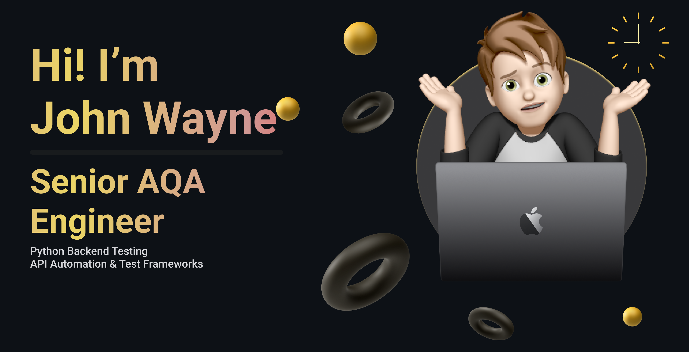

<!-- ============================= -->
<!--          BANNER SECTION       -->
<!-- ============================= -->

<h2 align="center">Senior AQA Engineer · Backend Test Automation · Python</h2>

  I automate the things that break at 3am — APIs, data pipelines, CI gates. 
  <strong>4+ years</strong> shipping stable test suites for production backends.

  
  
  

---

## What I bring to a team

| Area | What I actually do |
|------|---------------------|
| **API automation** | REST, SOAP, gRPC — Pytest + Requests, end-to-end contract validation |
| **Data validation** | PostgreSQL & Redis assertions, Pydantic response typing with strict mode |
| **CI/CD quality gates** | Blocking jobs on failure, pytest-xdist parallel runs (2–3× faster) |
| **Reporting** | Allure dashboards readable by devs, QA leads, and PMs |
| **Stability** | Retry strategies, flaky test analysis — **+30% pass rate on volatile environments** |

---

## Key results

- 🚀 **2–3× faster** test suite execution via parallel runs with pytest-xdist
- 🛡️ **Zero broken builds** reaching staging — CI gates catch regressions at the PR level
- 📈 **+30% test stability** through intelligent retry logic and flaky test isolation
- 📋 **Standardised test case templates** adopted across the QA team

---

## ⚙️ Tech Stack

<h3 align="center">🧩 Core (daily use)</h3>

  
  
  
  
  
  
  
  
  

<h3 align="center">🧪 Testing Workflow</h3>

  
  
  
  
  
  

---

## 🛠️ Open source

### [casely-qa-skill](https://github.com/JohnWayneeee/casely-qa-skill)
**PDF requirements → TestRail-ready test cases in 8 minutes.**  
Free AI skill for Claude Code, Cursor, and any AI IDE. Uses Docling OCR + atomic Markdown generation + Excel export matched to your team's column structure.

> *Built because writing test cases manually is the most expensive thing QA engineers do.*

### [ai-agent-skills](https://github.com/JohnWayneeee/ai-agent-skills)
**Drop-in instruction sets that make your AI agent actually useful.**  
A curated catalog of reusable skills — each one a self-contained prompt you plug into Claude Code, Codex, or any compatible agent runtime and invoke by name. No configuration, no boilerplate.

---

## 🌐 Let's talk

- 📢 **Telegram Channel:** [Join](https://t.me/+yojN8tBZNfQyNTky)
- 💼 **LinkedIn:** [Illia Karpenko](https://www.linkedin.com/in/ilia-karpenko-b4a166391/)

Open to: **senior AQA roles**, **backend test automation consulting**, and **open-source QA tooling collaboration**.

---

  <em>Tests should catch bugs, not create them. I keep that ratio in check.</em>

☕ <a href="https://buymeacoffee.com/JohnWayne">Buy me a coffee</a>

